  

Estudante de Engenharia da Computação com foco em sistemas embarcados e FPGA. Também trabalho com redes e infraestrutura de TI.

Sobre mim
Cursando o 8° semestre de Engenharia da Computação na FAINOR.
Selecionada em 2025 para o EmbarcaTech, programa de ensino e residência em sistemas embarcados, entre 100 estudantes da Bahia. Foi nele que estudei FPGA.
Integro o G.E.A.R. (grupo de robótica) e o projeto de extensão REAM, de robótica educacional. No G.E.A.R., até 2025, fiz parte da equipe de hardware de um robô de georreferenciamento.
Fundei o NPEC (Núcleo de Práticas em Engenharia da Computação).
Na VCA Construtora, atuo na equipe de TI, com redes e infraestrutura.
Competências

FPGA e HDL

   

Sistemas embarcados

       

Análise e automação

 

Projetos
Irrigação automática do solo. Sistema microprocessado com Arduino Uno, sensor de umidade, display LCD 16x2, LEDs indicadores e bomba DC, simulado no Tinkercad.
Ohmímetro digital. Leitura analógica de resistência no Arduino, exibida em um LCD 16x2 e controlada por uma máquina de estados finitos com cinco estados.
Compensador por lugar das raízes. Projeto de controle em Python (numpy, scipy e control) para G(s) = K / [s(s+1)(s+5)].
Busca em labirinto. Algoritmos de busca sem informação, com UCS usando fila de prioridade, em Python e C++.
Participações
CREAJr (2025): coordenadora de projetos do núcleo de Vitória da Conquista, com divulgação científica e networking entre estudantes. Integrei a equipe que representou a Bahia nas olimpíadas nacionais e ficou em 2° lugar.
Evento de robótica na FAINOR (2025): organizado com outros membros do CREAJr, com mais de 150 presentes.
Bahia Innovate Summit (Salvador, outubro de 2025): minha equipe ficou entre os 10 melhores projetos.
Monitora de Cálculo Diferencial e Integral III (2024).
Aulas de informática para idosos no centro de convivência (2024), com foco em inclusão digital.
